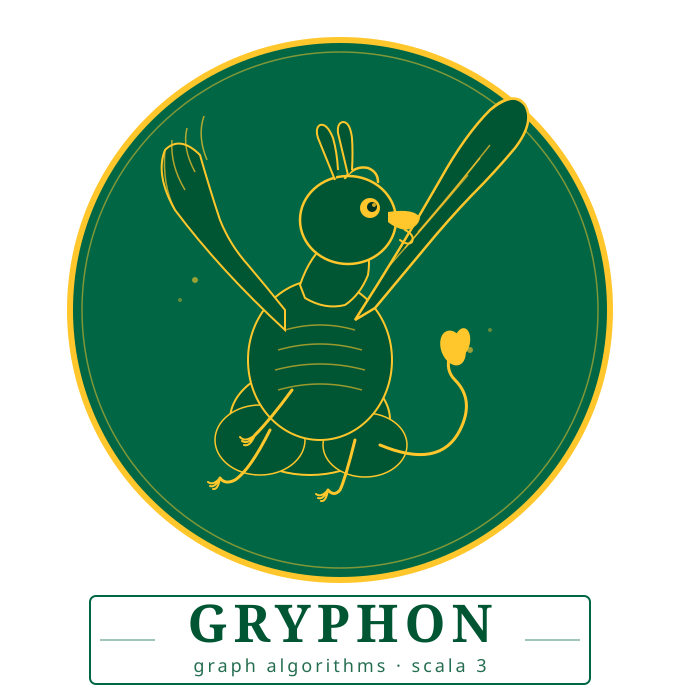

[](https://central.sonatype.com/artifact/com.phasmidsoftware/gryphon_3)
[](https://rchillyard.github.io/Gryphon/latest/api/)
[](https://rchillyard.github.io/Gryphon/latest/javadoc/)
[](https://app.codacy.com/gh/rchillyard/Gryphon/dashboard)
[](https://app.codacy.com/gh/rchillyard/Gryphon/dashboard)
[](https://dl.circleci.com/status-badge/redirect/gh/rchillyard/Gryphon/tree/main)
[](https://github.com/rchillyard/Gryphon)
[](https://github.com/rchillyard/Gryphon/blob/main/LICENSE)
[](https://github.com/rchillyard/Gryphon/commits/main)
[](https://github.com/rchillyard/Gryphon/issues)
[](https://github.com/rchillyard/Gryphon/issues?q=is%3Aissue+is%3Aopen+label%3Abug)

A Scala 3 graph algorithms library built on the
[Visitor](https://github.com/rchillyard/Visitor) typeclass traversal engine.
Additionally, an API allowing easy access to the library from Java.

Gryphon provides clean, purely functional implementations of the classic graph
algorithms from Sedgewick & Wayne, *Algorithms* (4th ed.), Chapter 4.
All algorithms are implemented using Scala 3 idioms — typeclasses, `given`/`using`,
and clean architectural separation between graph structure and traversal logic.

Gryphon is also intended as an artefact of the [DSAIPG](https://github.com/rchillyard/DSAIPG) (Java) repository
that supports the author's own textbook: _Data Structures, Algorithms, and Invariants - a Practical Guide_
(published by Cognella, 2025), hereinafter referred to as DSAIPG.

---

## Getting Started

Gryphon is published on Maven Central. Add it to your `build.sbt`,
where `x.y.z` is the latest version on Maven Central: it's shown on the [Sonatype Central](https://central.sonatype.com/artifact/com.phasmidsoftware/gryphon_3) badge at the top of this page.

```scala
libraryDependencies += "com.phasmidsoftware" %% "gryphon" % "x.y.z"
```

Gryphon 1.6.0 and later need Scala 3.9 or later; for Scala 3.7 or 3.8, use 1.5.1.

Full Scaladoc is at <https://rchillyard.github.io/Gryphon/latest/api/>, and the Java façade's
Javadoc is at <https://rchillyard.github.io/Gryphon/latest/javadoc/>.

Gryphon requires **Scala 3** and depends on
[Visitor](https://github.com/rchillyard/Visitor) (`com.phasmidsoftware %% visitor`),
which is pulled in automatically.

---

## Algorithms

Gryphon implements all eleven graph algorithms from Chapter 4 of
Sedgewick & Wayne, *Algorithms* (4th ed.):

| # | Algorithm | Class / Object |
|---|-----------|----------------|
| 4.1 | Depth-first search | `Graph.dfs` / `Graph.dfsAll` |
| 4.2 | Breadth-first search | `Graph.bfs` |
| 4.3 | Connected components | `ConnectedComponents` |
| 4.4 | Reachability | `Graph.dfs` on `DirectedGraph` |
| 4.5 | Topological sort | `TopologicalSort` |
| 4.6 | Strongly connected components (Kosaraju–Sharir) | `Kosaraju` |
| 4.7 | Minimum spanning tree (Prim) | `MST.prim` |
| 4.8 | Minimum spanning tree (Kruskal) | `Kruskal` |
| — | Minimum spanning tree (Borůvka) | `Boruvka` |
| 4.9 | Shortest paths (Dijkstra) | `ShortestPaths.dijkstra` |
| 4.10 | Shortest paths in DAGs | `AcyclicShortestPaths` |
| 4.11 | Shortest paths (Bellman–Ford) | `BellmanFord` |

Additionally, some algorithms and graph properties that are not directly covered in that chapter:

- **Cycle detection** — `Graph.isCyclic` (undirected and directed)
- **Bipartite checking** — `UndirectedGraph.isBipartite`
- **Connectivity** — `UndirectedGraph.isConnected`
- **Degree statistics** — `UndirectedGraph.degree`, `maxDegree`, `meanDegree`;
  `EdgeGraph.inDegree` and `outDegree`, which are defined for directed graphs too
- **Self-loop count** — `EdgeGraph.numberOfSelfLoops`
- **Union-Find** — `Connectivity` (used internally by Kruskal and Borůvka)
- **Graph reversal** — `DirectedGraph.reverse` (used internally by Kosaraju)

For the systematic comparison behind this list — every algorithm in Sedgewick & Wayne chapter 4
and in CLRS, each marked implemented, partial or missing, with the gaps named and sized — see
[docs/textbook-coverage.md](docs/textbook-coverage.md).

---

## Graph Types

Gryphon supports two concrete graph types, both backed by a `VertexMap`:

```scala
// Directed weighted graph
val g: DirectedGraph[Int, Double] = DirectedGraph.triplesToTryGraph(...).get

// Undirected weighted graph
val g: UndirectedGraph[Int, Double] = UndirectedGraph.triplesToTryGraph(...).get
```

Graphs are constructed from sequences of `Triplet[V, E, EdgeType]`, typically
parsed from a graph file using `GraphParser`:

```scala
val p = new GraphParser[Int, Double, EdgeType]
val triplets = TryUsing.tryIt(Try(Source.fromResource("mygraph.graph"))) { source =>
  p.parseSource[Triplet[Int, Double, EdgeType]](p.parseTriple)(source)
}.get
val graph = DirectedGraph.triplesToTryGraph[Int, Double](Vertex.createWithSet)(triplets).get
```

### Graph file format

Graph files use a simple line-based format. Lines beginning with `//` are comments.

```
// Directed weighted graph
0 > 1 0.5
1 > 2 1.2
2 > 0 0.8
```

```
// Undirected weighted graph
0 = 1 0.16
1 = 2 0.19
```

The separator `>` means directed; `=` means undirected.

---

## Scala Usage Examples

### Depth-first and breadth-first search

```scala
given Evaluable[Int, Int] with
  def evaluate(v: Int): Option[Int] = Some(v)

val visitor = JournaledVisitor.withQueueJournal[Int, Int]

// DFS from vertex 0
val dfsResult = graph.dfs(visitor)(0)
val visited = dfsResult.result.map(_._1).toSet

// BFS from vertex 0
val bfsResult = graph.bfs(visitor)(0)

// DFS over all components
val allVisited = graph.dfsAll(visitor).result.map(_._1).toSet
```

> **These calls do not promise a particular order.** Adjacency iteration is shuffled, so
> a second run may visit vertices in a different — and equally valid — order. Put
> `given Random = Random(42)` in scope when you need one fixed answer. See
> [Randomised iteration, and how to pin it](#randomised-iteration-and-how-to-pin-it).

### Topological sort

```scala
TopologicalSort.sort(dag) match
  case Some(order) => println(s"Topological order: $order")
  case None        => println("Graph contains a cycle")
```

### Shortest paths (Dijkstra)

```scala
given Ordering[Double] = scala.math.Ordering.Double.TotalOrdering
// Monoid[Double] comes from cats-kernel's implicit scope; no import is needed.

val result = ShortestPaths.dijkstra(graph, 0)   // graph must be a DirectedGraph
result.vertexTraverse(5).foreach(e => println(s"Shortest edge into 5: $e"))
```

### Shortest paths in a DAG (handles negative weights)

```scala
val result = AcyclicShortestPaths.shortestPaths(dag, 0)
result.vertexTraverse(3).foreach(e => println(s"Shortest edge into 3: $e"))
```

### Bellman–Ford (handles negative weights and detects negative cycles)

```scala
BellmanFord.shortestPaths(graph, 0) match
  case Some(result) => result.vertexTraverse(3).foreach(println)
  case None         => println("Negative cycle detected")
```

#### Choosing between them

On a DAG both work, and which is faster depends on the graph rather than on the
algorithm's complexity class.

`AcyclicShortestPaths` is O(V+E) whatever the shape: a topological sort, then one
pass relaxing each edge once. `BellmanFord` is queue-based, so its cost depends
on how often a vertex has to be re-relaxed — which depends entirely on how lucky
the queue order is. Measured on 1500-vertex DAGs:

| | `BellmanFord` | `AcyclicShortestPaths` |
|---|---|---|
| random DAG, 6000 edges, edges running low index → high | **1.7 ms** | 4.5 ms |
| a zero-cost chain plus an expensive direct edge to every vertex | 356.4 ms | **4.5 ms** |

In the first, the queue order is already topological, so Bellman–Ford makes a
single pass and wins. In the second, every vertex is settled by its expensive
direct edge and then re-relaxed as the cheap chain creeps forward, so it is
re-queued many times.

Note the second column: `AcyclicShortestPaths` costs the same on both, because it
cannot not. So reach for it when you want a bound you can rely on; Bellman–Ford
may well be quicker on a graph that suits it, and is the only choice if the graph
might have a cycle.


### Minimum spanning tree (Kruskal)

```scala
val mstEdges: Seq[Edge[Int, Double]] = Kruskal.mst(undirectedGraph)
val totalWeight = mstEdges.map(_.attribute).sum
```

### Minimum spanning tree (Borůvka)

```scala
val mstEdges: Seq[Edge[Int, Double]] = Boruvka.mst(undirectedGraph)
val totalWeight = mstEdges.map(_.attribute).sum
```

### Strongly connected components (Kosaraju)

```scala
val sccResult: SCCResult[Int] = Kosaraju.stronglyConnectedComponents(directedGraph)
// sccResult maps each vertex to its SCC id
val numSCCs = sccResult.values.toSet.size
```

### Graph properties

```scala
graph.isCyclic          // Boolean
graph.numberOfSelfLoops // Int
graph.inDegree(v)       // Int — for an undirected graph, the same as degree
graph.outDegree(v)      // Int

// Undirected only. These are not declared for a DirectedGraph, so calling one
// on a digraph is a compile error rather than an exception.
graph.isBipartite       // Boolean
graph.isConnected       // Boolean
graph.degree(v)         // Int
graph.maxDegree         // Int
graph.meanDegree        // Double — equals 2*M/N
```

For a directed graph, use `ConnectedComponents` for weak connectivity,
`StronglyConnectedComponents.kosaraju` for strong, and `inDegree`/`outDegree`
in place of `degree`.

---

## Java API

Gryphon provides a complete Java façade in the `com.phasmidsoftware.gryphon.java`
package, giving Java students access to all major graph algorithms without
exposure to Scala typeclasses, `given`/`using`, or companion object syntax.

Its API documentation is published separately from the Scaladoc, at
<https://rchillyard.github.io/Gryphon/latest/javadoc/>. The Scaladoc covers the Scala
library only — Scaladoc does not process Java sources — so the façade does not appear
there.

### Building with Maven

Insert the following into the `<dependencies>` block of your pom.xml:

````xml
<dependency>
  <groupId>com.phasmidsoftware</groupId>
  <artifactId>gryphon_3</artifactId>
  <version>x.y.z</version>
</dependency>
````

The Java API is the primary interface for readers of DSAIPG and/or INFO6205 students at Northeastern University.

Like the Scala API, the façade does not promise a particular traversal order: `dfs` and
`bfs` may return a different — equally valid — answer each time. Where the order can
reach the result, each method has a second form taking a `java.util.Random`, which is
the Java equivalent of `given Random` and makes the answer reproducible. See
[Randomised iteration, and how to pin it](#randomised-iteration-and-how-to-pin-it).

### Core types

| Class | Description |
|---|---|
| `Edge<V>` | Immutable unweighted edge with `from()`, `to()`, `reverse()` |
| `WeightedEdge<V, E>` | Extends `Edge<V>` with a typed `attribute()` |
| `Graph<V>` | Mutable lazy-builder façade; directed or undirected |
| `Connectivity<V>` | Mutable Union-Find façade for disjoint-set operations |
| `ShortestPaths` | Dijkstra's algorithm |
| `MinimumSpanningTree` | Prim's, Kruskal's, and Borůvka's algorithms |
| `WeightedGraph.fromResource` | Loads a graph directly from a `.graph` resource file |
| `ConnectedComponents` | Connected components of undirected graphs |
| `TopologicalSort` | Topological sort of DAGs; `isDAG` predicate |
| `ShortestPaths.bellmanFord` | Shortest paths with negative weights; detects negative cycles |
| `ShortestPaths.acyclic` | Linear-time shortest paths in a DAG |
| `StronglyConnectedComponents` | Kosaraju's algorithm |

### Building a graph from a resource file

Java students can load a graph directly from a `.graph` classpath resource,
avoiding verbose `addEdge` calls in test code:

```java
// Option 1 — Integer vertices, Double weights
WeightedGraph<Integer, Double> g = WeightedGraph.undirectedFromResource("prim.graph");

// Option 3 — custom vertex and edge types
WeightedGraph<Building, TunnelProperties> tunnels = WeightedGraph.undirectedFromResource(
    "tunnels.graph", Building::parse, TunnelProperties::parse);
```

The `.graph` format uses `=` for undirected edges and `>` for directed edges;
`//` introduces a comment line.

### Building a graph

`Graph<V>` is mutable in the Java idiom. Create it with a factory method and
add edges one at a time:

```java
// Unweighted directed graph
Graph<String> g = Graph.directed();
g.addEdge("A", "B");
g.addEdge("B", "C");
g.addEdge("C", "A");

// Weighted undirected graph. Note WeightedGraph, not Graph: a plain Graph<V>
// accepts a WeightedEdge but keeps no weight, so the algorithms cannot use it.
WeightedGraph<Integer, Double> w = WeightedGraph.undirectedWeighted();
w.addEdge(new WeightedEdge<>(0, 1, 0.26));
w.addEdge(new WeightedEdge<>(0, 7, 0.16));
w.addEdge(new WeightedEdge<>(1, 7, 0.19));
```

### BFS and DFS

Both traversals return a came-from map — a `Map<V, V>` where each entry
`v → parent` records who discovered `v`. **The start vertex is absent**: it has no
predecessor. So are unreachable vertices. This is the same convention as the
Dijkstra SPT, the Prim MST and the Kosaraju SCC map.

```java
Graph<String> g = Graph.undirected();
g.addEdge("A", "B");
g.addEdge("B", "C");
g.addEdge("C", "D");

Map<String, String> bfsTree = g.bfs("A");
boolean reachable = bfsTree.containsKey("D");   // true
String parent     = bfsTree.get("C");           // "B"

// Reconstruct path from D back to A: walk until the key is absent.
List<String> path = new ArrayList<>();
String v = "D";
path.add(v);
while (bfsTree.containsKey(v)) {
    v = bfsTree.get(v);
    path.add(0, v);
}
// path == ["A", "B", "C", "D"]

Map<String, String> dfsTree = g.dfs("A");
```

`dfs` explores only the component containing its start vertex. To cover the
whole graph, use `dfsAll`, which restarts from each undiscovered vertex and
returns a depth-first *forest*. One root per component is absent from the map,
so the number of absent vertices is the number of components.

```java
Graph<Integer> g = Graph.undirected();
g.addEdge(0, 1);
g.addEdge(2, 3);          // a second, disjoint component

g.dfs(0).size();          // 1 — only vertex 1, in the first component
g.dfsAll().size();        // 2 — both components, less one root each
```

To stop as soon as you reach a known target, use `bfsUntil`. The came-from map
then covers only what was discovered before stopping.

```java
Map<Integer, Integer> toGoal = g.bfsUntil(0, v -> v == 3);
```

It is named `bfsUntil` rather than being an overload of `bfs`, because a lambda
could not then be resolved against the `Function<V, Iterable<V>>` overload.

### Shortest paths (Dijkstra)

`ShortestPaths.dijkstra` returns a shortest-path tree (SPT) as a
`Map<V, WeightedEdge<V, Double>>`. Each entry `v → edge` records the cheapest
incoming edge to `v`. The start vertex is absent.

```java
WeightedGraph<Integer, Double> g = WeightedGraph.directedWeighted();
g.addEdge(new WeightedEdge<>(0, 1,  5.0));
g.addEdge(new WeightedEdge<>(0, 4,  9.0));
g.addEdge(new WeightedEdge<>(0, 7,  8.0));
g.addEdge(new WeightedEdge<>(4, 5,  4.0));
g.addEdge(new WeightedEdge<>(5, 2,  1.0));
// ... add remaining edges

// Option 1 — Double weights, no configuration needed
Map<Integer, WeightedEdge<Integer, Double>> spt = ShortestPaths.dijkstra(g, 0);

WeightedEdge<Integer, Double> edgeTo2 = spt.get(2);
System.out.println(edgeTo2.from());      // 5  (vertex 2 reached via vertex 5)
System.out.println(edgeTo2.attribute()); // 1.0 (the 5→2 edge weight)

// Reconstruct full path to vertex 2
List<Integer> path = new ArrayList<>();
int v = 2;
while (spt.containsKey(v)) {
    path.add(0, v);
    v = spt.get(v).from();
}
path.add(0, v); // add start vertex
// path == [0, 4, 5, 2]

// Option 3 — custom cost type: combine, zero, and comparator
Map<Integer, WeightedEdge<Integer, Double>> spt3 = ShortestPaths.dijkstra(
    g, 0,
    Double::sum,
    0.0,
    Comparator.naturalOrder());
```

### Shortest paths with negative weights (Bellman–Ford)

Dijkstra assumes no edge makes a path cheaper the further you go, so it is wrong
on negative weights. `ShortestPaths.bellmanFord` handles them. Where a negative
cycle is reachable from the source no shortest path exists — each lap round the
cycle is cheaper than the last — and the result is an empty `Optional`.

```java
WeightedGraph<Integer, Double> g = WeightedGraph.directedWeighted();
g.addEdge(new WeightedEdge<>(0, 1,  1.0));
g.addEdge(new WeightedEdge<>(1, 2, -2.0));
g.addEdge(new WeightedEdge<>(0, 2,  0.5));

Map<Integer, WeightedEdge<Integer, Double>> spt =
    ShortestPaths.bellmanFord(g, 0).orElseThrow();

spt.get(2).from();   // 1 — going via 1 costs −1.0, cheaper than the direct 0.5

// A negative cycle is reported rather than thrown:
g.addEdge(new WeightedEdge<>(2, 1, -1.0));
ShortestPaths.bellmanFord(g, 0);   // Optional.empty()
```

An Option 3 overload takes `combine`, `zero` and a `Comparator`, as Dijkstra's does.

### Shortest paths in a DAG

If the graph is acyclic, `ShortestPaths.acyclic` relaxes edges in topological
order, visiting each edge once. That is linear in the size of the graph whatever
its shape, and negative weights are safe, because a DAG has no cycle for them to
make cheaper. See "Choosing between them" below — linear is a guarantee, not
always a win.

```java
Map<Integer, WeightedEdge<Integer, Double>> spt = ShortestPaths.acyclic(dag, 0);
```

It throws `IllegalArgumentException` if the graph has a cycle; test first with
`TopologicalSort.isDAG(g)` if you are not sure.

### Graph properties and predicates

```java
Graph<Integer> g = Graph.undirected();
g.addEdge(0, 1);
g.addEdge(1, 2);
g.addEdge(2, 0);

g.order();              // 3 — the number of vertices, N
g.size();               // 3 — the number of edges, M
g.degree(0);            // 2
g.inDegree(0);          // 2 — same as degree, in an undirected graph
g.outDegree(0);         // 2
g.maxDegree();          // 2
g.meanDegree();         // 2.0, which is 2M/N
g.numberOfSelfLoops();  // 0

g.isCyclic();           // true
g.isConnected();        // true
g.isBipartite();        // false — a 3-cycle cannot be two-coloured
```

`order`, `size`, `numberOfSelfLoops` and `isCyclic` apply to both kinds of graph,
and `WeightedGraph` inherits all of them.

`inDegree` and `outDegree` apply to both as well. In an undirected graph every edge can be
traversed both ways, so the in-degree, the out-degree and the degree are the same number; in a
directed one they count arcs arriving and leaving, and a self-loop counts once towards each.

```java
Graph<Integer> d = Graph.directed();
d.addEdge(0, 1);
d.addEdge(0, 2);

d.outDegree(0);   // 2
d.inDegree(0);    // 0 — a source
d.inDegree(2);    // 1
```

Two groups do not apply to both:

- `degree`, `maxDegree` and `meanDegree` throw `GraphException` on a directed
  graph. A vertex of a digraph has an in-degree and an out-degree, not one
  degree — use those. `GraphException` is unchecked from 1.8.0, so Java callers
  can catch it; before that they could not, because the façade's methods do not
  declare it and javac rejects a `catch` for a checked exception the called
  method cannot throw.
- `isConnected` and `isBipartite` throw `GraphException` on a directed graph.
  Connectivity of a digraph has two meanings — weak (ignoring direction) and
  strong (every vertex reachable from every other) — and neither is assumed. Use
  `ConnectedComponents` for the first and `StronglyConnectedComponents.kosaraju`
  for the second. In Scala these are not declared on a directed graph at all, so
  the compiler rejects them; the façade checks at run time because Java cannot
  express that.

### Minimum spanning tree (Prim)

`MinimumSpanningTree.prim` returns the MST as a `Map<V, WeightedEdge<V, Double>>`
mapping each non-source vertex to its cheapest MST edge. The start vertex is absent.

```java
WeightedGraph<Integer, Double> g = WeightedGraph.undirectedWeighted();
g.addEdge(new WeightedEdge<>(0, 7, 0.16));
g.addEdge(new WeightedEdge<>(2, 3, 0.17));
// ... add remaining edges

// Option 1 — Double weights
Map<Integer, WeightedEdge<Integer, Double>> mst = MinimumSpanningTree.prim(g, 0);

double totalWeight = mst.values().stream()
    .mapToDouble(WeightedEdge::attribute)
    .sum(); // 1.81

List<WeightedEdge<Integer, Double>> mstEdges = new ArrayList<>(mst.values());
```

### Minimum spanning tree (Kruskal)

`MinimumSpanningTree.kruskal` returns the MST as a
`List<WeightedEdge<V, Double>>` in non-decreasing weight order.

```java
// Option 1 — Double weights
List<WeightedEdge<Integer, Double>> mst = MinimumSpanningTree.kruskal(g);

double totalWeight = mst.stream()
    .mapToDouble(WeightedEdge::attribute)
    .sum(); // 1.81

// Prim and Kruskal agree on total weight (graph has unique edge weights)
Map<Integer, WeightedEdge<Integer, Double>> primMst = MinimumSpanningTree.prim(g, 0);
double primTotal   = primMst.values().stream().mapToDouble(WeightedEdge::attribute).sum();
double kruskalTotal = mst.stream().mapToDouble(WeightedEdge::attribute).sum();
// primTotal == kruskalTotal == 1.81

// Option 3 — custom comparator
List<WeightedEdge<Integer, Double>> mst3 = MinimumSpanningTree.kruskal(
    g,
    Comparator.naturalOrder());
```
### Minimum spanning tree (Borůvka)

`MinimumSpanningTree.boruvka` returns the MST as a
`List<WeightedEdge<V, Double>>`. Unlike Kruskal, the list is not guaranteed
to be in weight-sorted order — edges are added round by round.

```java
// Option 1 — Double weights
List<WeightedEdge<Integer, Double>> mst = MinimumSpanningTree.boruvka(g);

double totalWeight = mst.stream()
    .mapToDouble(WeightedEdge::attribute)
    .sum(); // 1.81

// Option 3 — custom comparator
List<WeightedEdge<Integer, Double>> mst3 = MinimumSpanningTree.boruvka(
    g, Comparator.naturalOrder());
```

### Strongly connected components (Kosaraju)

`StronglyConnectedComponents.kosaraju` returns a `Map<V, Integer>` mapping
each vertex to an integer SCC id. Vertices sharing the same id are in the same SCC.

```java
Graph<Integer> g = Graph.directed();
g.addEdge(0, 5); g.addEdge(0, 2); g.addEdge(0, 1);
g.addEdge(5, 2); g.addEdge(2, 6); g.addEdge(6, 0); // cycle: 0→5→2→6→0
g.addEdge(3, 6); g.addEdge(3, 5); g.addEdge(3, 4);
g.addEdge(6, 4); g.addEdge(1, 4); g.addEdge(3, 2);

// Raw result — vertex to SCC id
Map<Integer, Integer> sccs = StronglyConnectedComponents.kosaraju(g);
boolean sameComponent = sccs.get(0).equals(sccs.get(2)); // true (both in {0,2,5,6})

// Count SCCs
int numSccs = StronglyConnectedComponents.count(g); // 4

// Group vertices by SCC
Map<Integer, Set<Integer>> groups = StronglyConnectedComponents.components(g);
// One group will be {0, 2, 5, 6}; the others are {1}, {3}, {4}
```

### Connectivity (Union-Find)

`Connectivity<V>` wraps Gryphon's disjoint-set implementation in a mutable
Java-idiomatic API. Two implementations are available:

```java
// Weighted Quick Union — O(log n) per operation
Connectivity<String> c = Connectivity.createLazy("A", "B", "C", "D");

// Weighted Quick Union with path compression — amortised near-O(1)
Connectivity<String> optimized = Connectivity.createOptimized("A", "B", "C", "D");

c.connect("A", "B");
c.connect("C", "D");

c.isConnected("A", "B"); // true
c.isConnected("A", "C"); // false
c.size();                // 2 (two components)

// Add a new singleton
c.put("E");
c.size();                // 3
```

### Two-tier API

Every algorithm method in the Java façade is available in two forms:

- **Option 1** — sensible defaults, works out of the box. Edge weights are
  read from `WeightedEdge.attribute()` and treated as `Double`. No
  configuration required.

- **Option 3** — the caller supplies functional interfaces
  (`BinaryOperator`, `Comparator`) that control how costs are combined and
  compared. This mirrors the typeclass abstraction of the Scala engine
  and is suitable for non-`Double` weight types or custom orderings.
  Algorithms that only compare costs, such as Prim, Kruskal and Borůvka, take
  a `Comparator` alone; those that accumulate them, such as Dijkstra and
  Bellman–Ford, also take a combiner and its identity.

```java
// Option 1 — Dijkstra with Double weights
Map<Integer, WeightedEdge<Integer, Double>> spt =
    ShortestPaths.dijkstra(g, 0);

// Option 3 — Dijkstra with a custom combiner, identity and comparator
Map<Integer, WeightedEdge<Integer, Double>> spt3 =
    ShortestPaths.dijkstra(g, 0,
        Double::sum,
        0.0,
        Comparator.naturalOrder());
```

### Directionality constraints

| Algorithm | Graph type required |
|---|---|
| `Graph.bfs` / `Graph.dfs` / `Graph.dfsAll` / `Graph.bfsUntil` | either |
| `Graph.order` / `size` / `numberOfSelfLoops` | either |
| `Graph.inDegree` / `outDegree` | either |
| `Graph.isCyclic` | either |
| `Graph.isConnected` / `isBipartite` | undirected |
| `Graph.degree` / `maxDegree` / `meanDegree` | undirected |
| `ShortestPaths.dijkstra` | directed |
| `ShortestPaths.bellmanFord` | directed |
| `ShortestPaths.acyclic` | directed, and acyclic |
| `MinimumSpanningTree.prim` | undirected |
| `MinimumSpanningTree.kruskal` | undirected |
| `MinimumSpanningTree.boruvka` | undirected |
| `StronglyConnectedComponents.kosaraju` | directed |

Calling an algorithm with the wrong graph type throws `IllegalStateException`
with a descriptive message. The exception is the degree family, which throws
`GraphException`: it is a property of the graph rather than an algorithm over
it, and the check happens in the Scala layer. `ShortestPaths.acyclic` throws
`IllegalArgumentException` if the graph is directed but has a cycle.

---

## Architecture

Gryphon is structured in five layers:

```
com.phasmidsoftware.gryphon
  .core       — Graph, VertexMap, Vertex, Edge, Adjacency, Connexion,
                Connected, Traversable, EdgeTraversable
  .adjunct    — DirectedGraph, UndirectedGraph, DirectedEdge,
                UndirectedEdge, Connectivity,
  .builder    — GraphBuilder
  .traverse   — ConnectedComponents, Kosaraju, TopologicalSort,
                ShortestPaths, MST, AcyclicShortestPaths, BellmanFord,
                Kruskal, Boruvka, TraversalResult, Connexions
  .parse      — GraphParser, BaseParser, Parseable
  .java       — Graph, Edge, WeightedEdge, Connectivity,
                ShortestPaths, MinimumSpanningTree,
                StronglyConnectedComponents, ConnectedComponents,
                TopologicalSort, JavaFacadeBridge
```

The traversal engine lives in the separate
[Visitor](https://github.com/rchillyard/Visitor) library, which provides
the five orthogonal typeclasses that drive all traversals:
`Evaluable[V, R]`, `Neighbours[H, V]`, `VisitedSet[V]`,
`Frontier[F[_]]`, and `Visitor[V, E, J]` — the last generic in its journal's
element type `E`, so a visitor recording bare nodes is as much a `Visitor` as one
recording `(node, result)` pairs.

---

## Design Principles

- **Scala 3 throughout** — typeclasses with `given`/`using`, `enum`, type aliases,
  context bounds, and clean separation of concerns.
- **Purely functional results** — all algorithms return immutable result types;
  any internal mutable state is strictly local to the algorithm.
- **Consistent type parameter ordering** — `V` (vertex type) always precedes
  `E` (edge attribute type) throughout the API.
- **`E: {Monoid, Ordering}`** — edge weight constraints use Visitor's `Monoid`
  rather than `Numeric`, keeping the constraint as light as possible.
- **No default implementations** — abstract methods on `Graph[V]` are always
  abstract, forcing each graph type to provide a correct concrete implementation.
- **Java API hides all Scala-isms** — no `Option`, typeclasses, `given`/`using`,
  or companion object syntax visible to Java callers.

### Randomised iteration, and how to pin it

**`dfs`, `bfs` and the algorithms built on them do not promise a particular order, and
never have.** A graph's adjacencies are a set, not a list; which neighbour you visit
first is not part of the problem statement, so it is not part of the answer. Gryphon
iterates adjacencies in a shuffled order to keep that honest.

Two runs can therefore give two different results, and both are correct. What varies is
**which** of several equally valid answers you get: a topological order is still a
topological order, a DFS tree is still a DFS tree, a minimum spanning tree still has
minimum weight. Nothing varies that the algorithm's specification pins down.

Shuffling is what keeps that promise enforceable in both directions. An algorithm that
quietly depends on insertion order has a bug nobody has noticed yet; with a fixed order
it produces correct-looking output that happens to rely on the sequence your edges went
in, and the dependence surfaces later on somebody else's data. Here it surfaces
immediately, as a test that will not sit still.

If you need a single answer rather than a valid one — comparing two runs, writing a
test, reproducing a figure — pin a seed. That is what the next section is for.

#### Pinning a seed

Every traversal and adjacency method takes a `using Random`, defaulted to `Random()`.
With nothing in scope, each call builds a fresh, unseeded generator:

```scala
graph.dfs(visitor)(0)          // fresh Random() — may differ between calls
```

Supply a generator and the order becomes reproducible:

```scala
given Random = Random(42)
graph.dfs(visitor)(0)          // same answer every time, for this seed
```

One `given` covers everything lexically below it, which is what makes a whole
computation reproducible rather than just one step of it.

#### The two container iterators

`Bag` and `Unordered` each expose both, and the distinction is load-bearing:

| | order | takes a `Random` |
|---|---|---|
| `iterator` | insertion order, deterministic | no — it is the `IterableOnce` iterator and *cannot* |
| `randomIterator` | shuffled | yes, always the caller's |

`randomIterator` is the only shuffled iteration in the library. Before 1.10.0 `iterator`
itself shuffled, drawing on a process-global generator, which made the order
unreproducible by construction — a seed at the call site could not reach it. Separating
the two also took `size`, `isEmpty` and `contains` off the PRNG, which they had no
business touching.

#### From Java

Java cannot write a `given`, but it can pass an argument. The order-sensitive façade
methods come in pairs:

```java
Map<Integer, Integer> any  = g.dfs(0);                        // a valid order
Map<Integer, Integer> same = g.dfs(0, new java.util.Random(42)); // this one, every time
```

The second is the exact equivalent of `given Random = Random(42)`. It takes a
generator rather than a seed so that one generator can span several calls — sharing it
across a sequence of traversals makes the whole computation reproducible, which a
per-call seed could not express.

The pairs exist on `dfs`, `bfs`, `dfsAll`, `bfsUntil`, `dijkstra`, `prim` and
`kosaraju`. The edge-list algorithms (Kruskal, Borůvka, Bellman–Ford, acyclic shortest
paths) sort or relax over all edges, so adjacency order cannot reach their answers and
they need no generator.

Two methods are stable for reasons of their own rather than by seeding.
`TopologicalSort` reads a memoized ordering, so repeated calls on one graph agree —
though the memoized value was computed unseeded, so a different run of your program may
memoize a different valid order. `ConnectedComponents.componentIds` assigns ids by
walking the vertex set, which is not shuffled, and so does not vary at all.

> Before 1.13.0 the façade pinned `Random(0)` internally and never varied. That was
> reproducible, but it told Java users something false — that `dfs` and `bfs` return a
> particular order — and left them no way to ask for a different one.

#### A known gap

`TopologicalSort.sort` takes no `Random` of its own, so it builds a fresh one per
vertex expansion rather than threading one through the traversal. A seed pinned at the
call site therefore does **not** reach it, and its orderings vary even under a `given`.
This is issue #131.

---

## Testing

The library has 750 tests covering all algorithms, graph properties, and
edge cases including:
- Disconnected graphs and forests
- Negative edge weights (Bellman–Ford, AcyclicShortestPaths)
- Negative cycle detection
- Self-loops
- Agreement between Bellman–Ford and Dijkstra on non-negative graphs
- Agreement between Prim, Kruskal, and Borůvka on MST weight
- Integration tests on the Northeastern University tunnel network (80 buildings, 79 edges, $6,648,954)
- Java API tests for all major algorithms

```bash
sbt test
```

---

## Versioning

| Version | Changes                                                                            |
|---|------------------------------------------------------------------------------------|
| 1.0.0 | Initial release                                                                    |
| 1.1.0 | First update post-release                                                          |
| 1.2.0 | Rename UnionFind→Connectivity; F-bounded DisjointSet; ConnectivityOptimized        |
| 1.2.1 | Java façade: Edge, WeightedEdge, Graph, GraphTraversal, Connectivity               |
| 1.2.2 | Java façade: ShortestPaths (Dijkstra), MinimumSpanningTree (Prim)                  |
| 1.2.3 | Java façade: MinimumSpanningTree (Kruskal), StronglyConnectedComponents (Kosaraju) |
| 1.3.0 | Added WeightedGraph                                                                |
| 1.4.0 | All BFS/DFS now use Visitor.traverse                                               |
| 1.5.0 | Borůvka MST; symmetric UndirectedEdge.equals/hashCode; Java façade: MinimumSpanningTree (Borůvka) |
| 1.5.1 | GraphBuilder (Scala); WeightedGraph.fromResource (Java); Graph/WeightedGraph resource-load constructors |
| 1.5.2 | Borůvka.mst returns Seq[Edge[V,E]] like Kruskal; Borůvka deduplication bug fix; tunnel integration tests |
| 1.5.3 | Refactoring: Connectivity is now a trait with factory methods; Java façade updates |
| 1.6.0 | Scala 3.9.0, Visitor 1.7.0, Flog 1.1.0; Borůvka refactoring. First published release since 1.5.1, so it also brings the 1.5.2 and 1.5.3 changes to Central |
| 1.7.0 | Java API for the rest of the Scala library: Bellman–Ford, acyclic shortest paths, graph properties and predicates, `dfsAll` and `bfsUntil`. Two bug fixes: an isolated vertex added with `addVertex` no longer vanishes when the graph is materialised, and `dfsAll` no longer revisits vertices. One `GraphException`: `util.GraphException` is now a deprecated type alias for `core.GraphException`, and the unusable `core.DAG` trait is removed (both **binary-incompatible** — see the notes below). Build and release standardisation: `-Werror`, the PVP version scheme, MiMa binary-compatibility checking, and logback-classic moved to Test scope (it is no longer pulled in by Gryphon's users) |
| 1.8.0 | `GraphException` is now unchecked, so Java callers can catch it; `addEdge` accepts only the kind of edge its graph admits; `prim` and `dijkstra` require an undirected and a directed graph respectively; `isConnected` and `isBipartite` are undirected-only; `inDegree`/`outDegree` added; the Java façade's `Connectivity.create` is renamed `createLazy`; type classes moved to `cats.kernel.Monoid`, adding a `cats-kernel` dependency, and the unused `util.HasZero` is removed; Javadoc published for the Java façade. **Breaking** — see "Migrating from 1.x" below |
| 1.8.1 | Bug fix: `UndirectedGraph.unit` built a `DirectedGraph`, so `undirectedGraph.addVertex(v)` returned a directed graph. Present in every earlier version. Binary compatible with 1.8.0 |
| 1.9.0 | `N` and `M` become `order` and `size` — the standard graph-theory terms, and the names the Java façade already used; the old names remain as deprecated aliases, so calling code still compiles. `size` moves to `EdgeTraversable`, where edges are known, and `VertexMap`'s mutable `edgeCount` is deleted. The traversals carry their working state immutably: with those two, no mutable state remains in the permanent structure of a graph. `DirectedGraph` and `UndirectedGraph` share a new `AbstractAdjunctGraph` base, and `unit` and `triplesToTryGraph` return the concrete graph type rather than `Graph[V]`. Removed: `RelaxableVertex` with its factory and alias, superseded in 0.2.5; `Traversable.bfse`, a stub that returned its own argument; and the unreferenced package-private `java.GraphTraversal`. `TopologicalSort.sort` was quadratic and is now linear — 127ms to 5.6ms on a 1500-vertex DAG — which also makes `AcyclicShortestPaths` some 48 times faster, since the sort was all of its cost. **Breaking** — see "Migrating from 1.8" below |
| 1.10.0 | Moves to [Visitor 1.8.0](https://github.com/rchillyard/Visitor/releases/tag/V1.8.0) and **generalises the traversal entry points over the journal's element type**: `dfs`, `bfs` and `dfsAll` on `Traversable`, `Graph`, `AbstractGraph` and `VertexMap` now take `Visitor[V, E, J]` for any element type `E`, in place of a form that fixed the journal to `(V, Option[R])`. They also drop their `using Evaluable[V, R]`, which had become dead — Visitor's engine no longer asks for one, since a visitor carries its own. The practical gain is that Visitor's `SimpleVisitor` (bare nodes, no `Evaluable`, no pair allocated per visit) and `ParentedVisitor` (which can see the node a vertex was reached from) now work through every Gryphon traversal entry point; previously the signature rejected them. Both `Monoid as _` import exclusions are gone, Visitor 1.8.0 having removed `core.Monoid`. **Breaking**: dropping the `Evaluable` parameter changes the erased signature of 27 methods — callers passing it explicitly should remove it; callers relying on the implicit need no change beyond recompiling |
| 1.11.0 | **Randomised iteration is now reproducible.** Gryphon shuffles iteration deliberately, so that algorithms are not accidentally sensitive to insertion order, but there were two sources of randomness and they disagreed about where the generator came from: `VertexMap.randomAdjacencies` took the caller's, while `Bag.iterator` picked up an ambient, process-global, unseeded `Bag.random`, ignoring any `Random` in scope. A seed pinned at a call site therefore did real work on one path and nothing at all on the other. `Bag.iterator` now returns insertion order — it is also the `IterableOnce` iterator, so it cannot take a generator — and shuffling moves to the new `Bag.randomIterator(using Random)`, mirrored on `Unordered`. `filteredAdjacencies` takes `using Random` and uses it, so both adjacency paths draw from the same place, and `Bag.random` is deleted. A caller's `given Random` always wins over the parameter default, which is the whole difference from the ambient value. `getConnexions` and `Connexions.create` take a `Random` too, without which they could not forward one and a pinned seed stopped at their signatures. Four pieces of API that nothing used are retired in the same release: `TraversalResult.edgeTraverse` moves to the edge-keyed branch, so the vertex-keyed one no longer carries a method whose only behaviour was to throw; `EdgeList` and `VertexPairList`, each of whose single consumer did nothing but unwrap it, move to the test tree, taking `VertexMap.createFromVertexPairList` with them and simplifying `addEdges` to take a plain `Seq`. **An attributeless connection is no longer admitted into an attributed graph.** A `VertexPair` — a connection carrying nothing — is all a graph needs unless its edges have an attribute such as a weight, but both graph flavours used to accept one into a graph whose edge type was, say, `Double`, and then lie about the type: the directed side cast an `OrderedEdge` to `DirectedEdge[V, E]`, and the undirected side put `None` in a field typed `E`. Reading `.attribute` on such an edge threw `ClassCastException`, at a use site far from the construction that caused it. The new `AbsentAttribute` type class decides whether `E` has a value meaning "no attribute" — `Unit` does, and it is `()` — and `triplesToTryGraph` now returns a `Failure` naming the offending triplet instead. A graph can therefore no longer mix attributed and attributeless edges. The unweighted traversals are also collapsed into one implementation: Gryphon had two APIs for a single operation — run a DFS or BFS, map each visited vertex, return a `TraversalResult` — one carried by `Traversable.vertexMappedTraversalDfs`/`Bfs` and the other by `DFSTraversal`/`BFSTraversal`, which had no callers at all. They now share `UnweightedTraversal`, which mirrors `WeightedTraversal` and takes the `fulfill` function that was the only difference between them; the `Traversable` methods keep their signatures and delegate. **Breaking** — see "Migrating from 1.10 to 1.11.0" below |
| 1.12.0 | **Building a graph from inconsistent triplets now fails instead of printing to stderr.** `fromTriplets` checked that the finished graph held as many adjacencies as its triplets described, wrote `WARNING: 3 != 4` to `System.err` when it did not, and built the graph anyway. The check itself was wrong: `createVerticesFromTriplet` deliberately gives a self-loop one adjacency on one vertex, while the count expected two for every two-way triplet whatever its ends, so every self-loop in an undirected graph produced a spurious warning — two of the test suite's own graphs did so on every run. The count now allows for self-loops, and a genuine mismatch is a `Failure`, framed as an internal invariant: if the graph does not hold what the triplets described, that is Gryphon's fault and a line on stderr gives a caller nothing to act on. The orientation warning beside it, which fires on no tested path, stays — but goes to an SLF4J logger rather than stderr, so an application can route or silence it. **`src/main` now writes nothing to `System.err`.** Removed: `ShortestPaths.undiscoveredEdges` and `ShortestPaths.undiscoveredVertices`, which duplicated the methods of the same names on `Graph` with the receiver moved into a parameter, and which nothing called — not the library, not the tests, not the Java façade. `Graph`'s pair survives unchanged, and its name is under review, since `filteredAdjacencies(_ => true)` filters nothing and `undiscoveredVertices` returns `Nil` on an undirected graph. The scaladoc was also swept against the signatures: five orphaned blocks (two of which had been separated from their methods, leaving `isCyclic` and `maxDegree` undocumented), twenty-four missing `@param` tags — seventeen of them the context parameters added in 1.11.0 — and several documented types that were simply wrong. Gryphon now builds against **Visitor 1.9.0**, which adds in-order traversal for binary trees, renames `Traverse` to `Visits`, splits `Behaviours.scala` into one file per type class, and eliminates the `misc` package. None of those names appears in Gryphon, so the upgrade is a version bump and nothing more here; an application that reached through Gryphon to Visitor's `Traverse` or `misc` will need Visitor's own migration note. **A triplet whose orientation disagrees with the graph is now refused.** The second half of the same defect: building a `DirectedGraph` from an undirected triplet, or the reverse, used to write a warning — to `System.err`, then to a logger — and then use the triplet anyway, so the caller received a `Success` containing a graph built partly from data the library had just called wrong, and learned of it only if somebody was reading the log. It is the same kind of thing as a parse error, so it now takes the same exit: a `Failure` naming the offending triplet and saying what to do. **`Graph.undiscoveredEdges` is renamed `adjacentEdges`, and `Graph.undiscoveredVertices` is deleted.** Neither name described its result — `undiscoveredEdges` was `filteredAdjacencies(_ => true)`, which filters nothing — and the names were left over from a design in which the caller tracked visited state, before the traversal engine took that over. `undiscoveredVertices` is deleted rather than renamed because `adjacentVertices` already does the job and does it correctly on undirected graphs, where the deleted method returned `Nil`. **The Java façade now throws a `GryphonException` it can name**, with the Scala throwable as its cause, instead of rethrowing whatever a `Try` held — so a Java caller can tell "no such resource" from "the file parsed but describes an inconsistent graph" without naming a Scala class the façade otherwise hides. **`Boruvka.mst` no longer hangs on a disconnected graph.** Its only exit was "exactly one component remains", which a disconnected graph never reaches: once each component is internally spanned there are no crossing edges, so nothing merged and the tail-recursive loop spun with identical arguments — a hang rather than a wrong answer. It now terminates when a round adds no edge, which is correct for both cases and returns the minimum spanning forest. `Kruskal.mst` was already correct, having no early exit to mislead it, and `MST.prim`'s behaviour of returning only the start vertex's component is now documented and tested rather than merely true. **`Traversable.graphNeighbours` is now `protected[core]`.** It is derived state — a type class instance built from `adjacentVertices` — and was public only because narrowing it was awkward. Note that this is a *source* break and not a binary one: Scala enforces qualified access at compile time, so the method remains public in the bytecode and MiMa is silent. A caller outside `com.phasmidsoftware.gryphon.core` that used it will no longer compile. **Breaking**: the two 1.11.0 removals, the rename and deletion above, the refusal of mismatched triplets, the façade's exception type, and the `graphNeighbours` narrowing (source only) |
| 1.13.0 | **The MST algorithms agree on a return type.** `Kruskal.mst` and `Boruvka.mst` returned a bare `Seq[Edge[V, E]]` while `MST.prim` returned a `TraversalResult`, so no caller could write one function over "an MST result". They now return the edge-keyed `TraversalResult`, which is what an edge list in order of addition actually is: positional, with no meaningful vertex key, and an order that means something — ascending weight for Kruskal, round order for Borůvka. Prim's result is a parent map and stays vertex-keyed, so the two branches of `TraversalResult` now express a real distinction instead of one being decoration; the edge-keyed branch previously had no producer outside a test. It extends `Seq`, so `map`, `exists`, `head` and `sorted` all work as before and most callers need no change at all. **Expensive graph properties are computed once.** `isConnected`, `isCyclic`, `isBipartite`, `maxDegree` and `meanDegree` become `lazy val`s, and `DirectedGraph` gains `topologicalOrder`, which `isCyclic` is derived from and which `AcyclicShortestPaths` now uses instead of sorting again — so a caller who checks `isDAG` first, as the Java façade's own scaladoc tells them to, no longer pays for two topological sorts. A `lazy val` is safe where a mutable cache would not be: a derived graph is a new object with its own uninitialised field, so there is nothing to invalidate. **`VertexMap.logger` is removed, and `slf4j-api` with it.** Nothing ever logged through it, and since 1.12.0 made the orientation warning a `Failure` there is no logging call anywhere in `src/main`. `flog` stays: it is a debugging tool, so zero call sites is its normal state and not evidence it is unused. **A graph can now be rendered, not only built.** `SerializableGraph.serialize` existed but could not be reached from a real graph, and what it emitted could not be read back: `0,1,Some(5.0)` — comma-separated where the parser wants whitespace, Scala's `Option.toString` where it wants a bare number, and no edge type at all, so directedness was lost. `EdgeGraph.unbuild` converts a graph into an `EdgeList` — one of three description shapes, which is why it is a conversion rather than `Graph` extending `SerializableGraph` — and `serialize` now writes the parser's own format. `Parseable` gains `render` as the inverse of `parse`, defaulting to `toString`, which is correct for every type here except `EdgeType`, whose `toString` is "Directed" where the parser reads ">". `EdgeList` and `VertexPairList` return to `src/main` for this, having been moved out in 1.11.0 when nothing used them. The round-trip property — parse, build, unbuild, serialize, parse — is now asserted on a real graph in both directions, which is the test whose absence let all of that sit undetected. **One of those description shapes was a duplicate.** `ProtoConnexions` and `VertexPairList` were the same type written twice — same field, same `triplets` body, differing only in that one fixed `Z` to `EdgeType` and extended `Pairs` — so the 2×2 of attributed-or-not against edge-objects-or-tuples had one cell occupied twice and another empty. `ProtoConnexions` is removed: it was the name nothing used, its sole call site being `createFromPairs` and its `parse` having none at all. `VertexPairList` keeps the name, widens to `[V, Z]` so `createFromPairs` need not narrow, and takes `parse` across, where it gains the test it never had. **Randomised iteration is documented at last.** The README said nothing about it: that adjacency iteration is deliberately shuffled, that every traversal takes a `using Random` defaulted to a fresh one, that pinning a seed makes a run reproducible, or that the Java façade pins its own and so never varies. A Scala caller who ran DFS twice, got two answers and came here to find out why found nothing, while the Java half of the same documented API behaved differently without saying so. There is now a section under Design Principles, with pointers from the first traversal example and the Java API preamble. **The Java façade stops pinning its own seeds, and takes one instead.** It pinned `Random(0)` at ten sites (`Random(42)` at one, for no recorded reason), which bought reproducibility by telling Java users something false: that `dfs` and `bfs` return a particular order. `dfs`, `bfs`, `dfsAll`, `bfsUntil`, `dijkstra`, `prim` and `kosaraju` now each have a second form taking a `java.util.Random` — the Java equivalent of `given Random`, and a generator rather than a seed so that one can span several calls. `componentIds` deliberately has no such form: `ConnectedComponents.components` accepts a generator and ignores it (#143), so offering one would be a lever connected to nothing. **Breaking**: Java callers relying on the old fixed order must now pass a generator; and the two MST result types, the removal of `VertexMap.logger`, `serialize` taking a `Parseable[Z]`, `size` becoming final on the edge-keyed result (a consequence of extending `Seq`, which no caller can observe), and the removal of `ProtoConnexions` |

### Migrating from 1.10 to 1.11.0

Most code needs no change beyond recompiling. The generator parameters added in this release all
carry defaults, so existing call sites still compile.

These cases do need attention:

- **If you called `bag.iterator` expecting a shuffled order**, you now get insertion order. Use
  `bag.randomIterator`, with a `given Random` in scope, to get the old behaviour — this time
  reproducibly.
- **If you implemented `Bag` or `Unordered` yourself**, you must now also implement
  `randomIterator(using Random)`.
- **If you called `VertexMap.addEdges(edgeList)`**, pass the sequence instead:
  `addEdges(edgeList.edges)`, or simply hold a `Seq[Edge[V, E]]` in the first place. `EdgeList`
  itself has moved to the test tree, along with `VertexPairList`.
- **If you called `VertexMap.createFromVertexPairList(vpl)`**, it is now
  `VertexMap[V].addVertexPairs(vpl.pairs)`, which is what that method did.
- **If you loaded a `.graph` file with no attribute column**, such as `dag.graph` or
  `dfsu.graph`, build it as `[V, Unit]` rather than `[V, Double]`. The latter used to appear to
  work and produced edges whose `attribute` threw when read. A file that mixes weighted and
  unweighted lines no longer loads at all, into any graph.
- **If you implemented your own edge-attribute type that should accept absent attributes**,
  give it a `given AbsentAttribute[YourType]` whose `maybeValue` is the value standing for
  absence. Without one, attributeless triplets are refused, which is the right default.
- **If you constructed `DFSTraversal[V]()` or `BFSTraversal[V]()`**, those still work and still
  mean the identity traversal. What changed is that both now carry a `fulfill` function, so
  `DFSTraversal(f)` maps each visited vertex through `f` — which is what
  `vertexMappedTraversalDfs(f)` does, and that method now delegates here. Pattern matches on
  these case classes, and uses of `copy()`, need updating.
- **If you called `edgeTraverse` on a `TraversalResult`**, the method now exists only on the
  edge-keyed branch, which is the only place it ever worked — on a vertex-keyed result it
  threw. `TraversalResult.edgeTraversal` returns `AbstractEdgeTraversalResult`, so code that
  takes its result and calls `edgeTraverse` needs no change.

If you want reproducible traversals, put a seeded generator in scope:

```scala
given Random = Random(42)
```

Every randomised path now consults it, which was the point: before this release, that `given`
reached the `randomAdjacencies` path and not the bag path, and the compiler reported it as an
unused definition — which, under `-Werror`, made correct-looking code fail to build.

This matters most for results that depend on adjacency order. Which predecessor
`getConnexions` records for a vertex, and so what `Connexions.create` returns, is one such:
on an undirected graph a vertex has several possible predecessors and the traversal records
whichever it reached first. Pin a seed if you need that to be repeatable.

### Migrating from 1.8 to 1.9.0

Most code needs no change at all, and the rest the compiler will find for you. Unusually for a
breaking release, the two most visible changes are *deprecations* rather than removals: `N` and `M`
still compile.

| 1.8 | 1.9.0 | Why |
|---|---|---|
| `graph.N` | `graph.order` | *Order* is the standard graph-theory term for the number of vertices, and is what the Java façade has always called it. `N` still works, deprecated. |
| `graph.M` | `graph.size` | Likewise *size* for the number of edges. `M` still works, deprecated. A single capital letter also reads as a type parameter in Scala, which these are not. |
| `RelaxableVertex`, `Vertex.createRelaxableWithSet`, `DiscoverableRelaxableVertex` | the traversal API — `ShortestPaths.dijkstra` and friends | Relaxation moved into the traversal in 0.2.5, when the frontier became `(cost, vertex)` tuples. Nothing in the library had used these since. |
| `Traversable.bfse` | — | It was a stub that returned its own argument, so it reported every graph as having no edges. Nothing called it. |
| `VertexMap.M` | `graph.size` | It read a mutable counter that `+` incremented on the *receiver* while returning a map whose own count was always 0. Counting edges belongs to the graph. |
| implementing `Traversable` or `Graph` yourself | implement `order`; implement `size` on `EdgeTraversable` | `size` moved down to `EdgeTraversable`, because counting edges needs to know what an edge is — a `VertexMap` is a `Traversable` and cannot tell half an undirected edge from a whole directed one. |
| subclassing `AbstractVertexTraversalResult` | `unit` returns your concrete type | So that `+` need not cast its own result back down. |
| `EdgeList[V, E, Z]` with an unrelated `Z` | `Z >: EdgeType` | `Z` was unbounded, which made a cast inside `triplets` sound only for `Z = EdgeType` — the one instantiation anyone uses. |

Unchanged, in case you expect otherwise: `directedGraph.addEdge(e)` still takes a `DirectedEdge`
and still returns a `DirectedGraph`, though its erased signature moved to the new
`AbstractAdjunctGraph` base; and every algorithm gives the same answers as in 1.8.1.

### Note on 1.9.0: the traversals are now pure

`isCyclic`, `isBipartite`, `BellmanFord`, `AcyclicShortestPaths` and `getConnexions` carried their
working state in mutable collections. They now thread it immutably. Results are identical — this is
an internal change, and each of those methods was already referentially transparent.

It is not free, and the cost was measured rather than assumed, on a 1491-vertex, 6000-edge graph:

| | 1.8.1 | 1.9.0 |
|---|---|---|
| `isCyclic` | 0.023 ms | 0.061 ms |
| `isBipartite` | 0.031 ms | 0.081 ms |
| `BellmanFord.shortestPaths` | 0.800 ms | 1.125 ms |
| `getConnexions` | 3.155 ms | 3.851 ms |

Two algorithms that did not change — `TopologicalSort` and `filteredAdjacencies` — were measured
alongside as controls and came out at 1.00–1.03×, which is what makes the rest readable as signal.

With these, and with `VertexMap`'s `edgeCount`, no mutable state remains in the permanent structure
of a graph. The one exception left in the library is `GraphTraversal`'s decrease-key bookkeeping for
Dijkstra and Prim, which is an algorithmic question rather than a refactor.

### Migrating from 1.x to 1.8.0

Most code needs no change. Everything below is a compile error rather than a silent change of
behaviour, so the compiler will find each site for you.

| 1.x | 1.8.0 | Why |
|---|---|---|
| `com.phasmidsoftware.gryphon.util.GraphException` | `...core.GraphException` | The two identical classes are now one. The old name is a deprecated alias and still compiles; the class is gone from the jar, so recompile. |
| `GraphException` caught as a checked exception in Java | unchecked | It extends `RuntimeException`, so a Java caller can finally write `catch (GraphException e)` — previously javac refused. |
| `trait DAG[V, E]` | `AcyclicShortestPaths.shortestPaths`, or `ShortestPaths.acyclic` from Java | `DAG` extended the `DirectedGraph` case class, so nothing could implement it. Nothing did. |
| `trait HasZero[T]` | `cats.kernel.Monoid[T]` | Unused dead code; Cats is the answer its own comment pointed at. |
| `undirectedGraph.addEdge(someDirectedEdge)` | use an `UndirectedEdge` | It used to be accepted and silently mishandled: the adjacency was added, so `degree` counted it, while `edges` and `M` did not. |
| `MST.prim(traversable, start)` | `MST.prim(undirectedGraph, start)` | Prim needs an undirected graph; the signature now says so. |
| `ShortestPaths.dijkstra(traversable, start)` | `ShortestPaths.dijkstra(directedGraph, start)` | As above, for a directed graph. |
| `directedGraph.isConnected` / `.isBipartite` | `ConnectedComponents` (weak) or `Kosaraju` (strong) | They used to throw `UnsupportedOperationException`; now they are not declared for a digraph, so the compiler says so. From Java, they throw `GraphException`. |
| `visitor.core.Monoid` / `visitor.core.Zero` bounds | `cats.kernel.Monoid` | Same abstraction, with laws and standard instances. `identity` is called `empty`. A `Zero` bound becomes a `Monoid` bound. |
| Java: `Connectivity.create(…)` | `Connectivity.createLazy(…)` | The old name read as "the default one" when it is the *unoptimised* one. It now matches the Scala layer it delegates to, where the pair has always been `createLazy` and `createOptimized`. "Lazy" means without path compression, not lazily evaluated. |
| `import com.phasmidsoftware.visitor.core.given` for `Monoid[Double]` | delete the import | `cats-kernel` supplies it through the implicit scope. |

Unchanged, in case you expect otherwise: `Ordering` is still `scala.math.Ordering` rather than
`cats.kernel.Order`; `degree`, `maxDegree` and `meanDegree` are still undirected-only; and the Java
façade's class and method names are the same throughout, so Java code that compiled against 1.7.0
compiles against 1.8.0 unless it caught `UnsupportedOperationException` from the two predicates.

### Note on 1.7.0: `GraphException`

Up to 1.6.0 Gryphon had two identical `GraphException` case classes, `core.GraphException` and
`util.GraphException`. They were unrelated types, so catching one did not catch the other, and which one a
method threw was effectively arbitrary. From 1.7.0 `core.GraphException` is the only one, and
`util.GraphException` is a deprecated alias for it.

**Source compatible:** the old name still names the type, constructs the exception and works as a pattern,
so existing code compiles unchanged — with a deprecation warning. Change the import to
`com.phasmidsoftware.gryphon.core.GraphException` to clear it.

**Not binary compatible:** a type alias is erased, so the class `com.phasmidsoftware.gryphon.util.GraphException`
is no longer in the jar. Code compiled against 1.6.0 or earlier must be recompiled. This is why 1.7.0 is a
minor release rather than a patch.

### Note on 1.7.0: `core.DAG` removed

The trait `com.phasmidsoftware.gryphon.core.DAG` has been removed. It extended the `DirectedGraph` case
class, so nothing could implement it — a case class may not extend another case class — and nothing in the
library referenced it. No working code can have depended on it, but it was a public type, so its removal is
listed here with the other binary-incompatible change above. For shortest paths in a DAG, use
`AcyclicShortestPaths.shortestPaths` (Scala) or `ShortestPaths.acyclic` (Java).

---

## License

This project is licensed under the MIT License — see the
[LICENSE](LICENSE) file for details.

## Related Projects

- [Visitor](https://github.com/rchillyard/Visitor) — the typeclass-based
  graph traversal engine that Gryphon builds on
- [Number](https://github.com/rchillyard/Number) — complex number support
  (planned for a future quantum computing library)
- [TableParser](https://github.com/rchillyard/TableParser) — tabular data
  parsing used in Northeastern University coursework